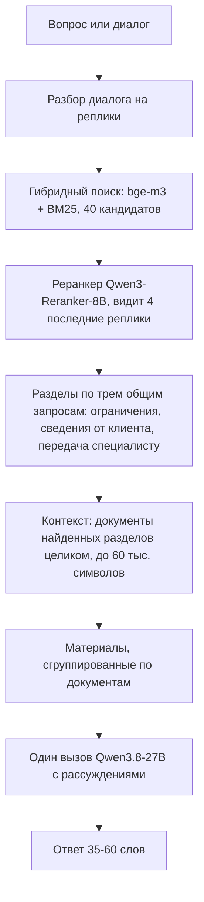

# Архитектура решения V9 и отличия от V7 и V8

Состояние на 11.11.2026, ветка `s1-reasoning-fix`, коммит `0abe325`. Архив сабмита: `dist/V9-wide.zip` (собирается командой `python build_zip.py`).

Это версия в `core/` и финальный сабмит. На платформе: 69.46 и 65.70 при повторе того же архива.

| Версия | Балл на платформе | Время прогона | Суть |
|---|---|---|---|
| FINAL-rerank | 52.755 | 145 с | обычный RAG, разделы до 10 тыс. символов, без рассуждений |
| V7-think | 62.099 | 485 с | промпт по рецепту эталона, банк образцов, точный поиск, рассуждения |
| V7-wide | 65.306 | 433 с | V7-think + документы целиком до 60 тыс. символов |
| V8-wide | 65.747 | 596 с | V7-wide + границы документов и правила против ошибок на стыке продуктов |
| V9-wide | 69.460 / 65.701 | 488 / 472 с | V8-wide + плотность фактов, уверенные формулировки, вежливость |

Разница между V7-wide и V8-wide (0.4 балла) меньше шума между одинаковыми архивами (2.6).

## 1. Как устроен ответ на вопрос

Одно ядро `core/` работает и в сабмите (`core/solution.py`), и в веб-чате (`web/app.py`). На один вопрос уходит один вызов LLM, один запрос эмбеддинга и один запрос реранкера.

### Подготовка базы (`core/kb.py`)

- Архив базы разбирается на разделы по заголовкам первого-третьего уровня. У каждого раздела есть "крошка": путь заголовков от названия документа.
- Таблицы pandoc превращаются в строки "колонка: значение", чтобы оговорка не отрывалась от числа.
- Двойные и тройные дефисы pandoc заменяются на тире; заголовок, приклеенный к абзацу при выгрузке, открывает свой раздел.
- Длинные разделы режутся на куски до 1500 символов для эмбеддингов; в контекст разделы возвращаются целиком.

### Поиск (`core/retrieval.py`)

1. Гибридная оценка каждого куска: 0.85 от близости эмбеддингов bge-m3 и 0.15 от BM25. В диалоге к запросу подмешиваются прошлые реплики клиента (вес 0.3 для эмбеддингов, 0.5 для BM25).
2. 40 лучших кандидатов переупорядочивает реранкер. Он получает не одну последнюю реплику, а четыре последние реплики диалога: по одной реплике не понять, о чем уточняющий вопрос. Порядок реранкера сливается с порядком первого этапа.
3. Три общих запроса ("ограничения и оговорки", "какие сведения нужны от клиента", "когда вопрос передать специалисту") заранее превращены в эмбеддинги. Для каждого берутся два раздела, близких одновременно к вопросу и к этому запросу, и ставятся первыми. Названия файлов и разделов базы в коде не зашиты.
4. Контекст набирается по порядку: каждый найденный раздел тянет за собой весь свой документ, пока хватает бюджета в 60 тыс. символов. Бюджет ограничивает промпт при любом размере базы.

Все внешние вызовы имеют запасной путь: без реранкера остается порядок первого этапа, без эмбеддингов работает один BM25.

### Сборка промпта (`core/pipeline.py`, `core/prompts.py`)

- Материалы сгруппированы по документам в блоках `<document title="...">`, чтобы модель видела, к какому продукту относится каждое утверждение.
- История диалога передается настоящими репликами чата. После материалов последние реплики повторяются еще раз, рядом с вопросом: за большим блоком материалов они иначе теряются.
- Системный промпт состоит из правил ответа, банка образцов (`core/examples.py`: 18 эталонных ответов из демо-набора) и семи образцов поведения (отказ не по теме, запрос менеджера, запрещенные к раскрытию сведения и другие).

### Генерация (`core/llm.py`, `core/solution.py`)

- Qwen3.8-27B отвечает с рассуждениями (`REASONING_EFFORT = "xhigh"`), лимит 4096 токенов и тайм-аут 180 секунд на вызов.
- Если рассуждения съели лимит или ответ обрезан, запрос повторяется, последняя попытка идет без рассуждений. Обрезанный текст в ответ не попадает.
- В сабмите работает защита по времени: рассуждения отключаются в последний момент, когда оставшиеся вопросы иначе не успеть к крайнему сроку в 18 минут (лимит платформы 20), реранкер при этом остается. Вызов с рассуждениями, не уложившийся в 120 секунд, переспрашивается без рассуждений. Файл `submission.csv` пишется сразу и обновляется атомарно. Подробности: `OPTIMIZATION_V9.md`.

### Веб-чат (`web/app.py`)

К тому же ядру добавлены: параллельный LLM-классификатор реплики (обычный вопрос, уместно предложить менеджера, клиент сам просит менеджера), форма заявки с ФИО, телефоном и компанией, резюме диалога для менеджера, история всех сессий в SQLite, режим отладки с временем этапов и использованными разделами базы. Ответ в чате идет потоком по мере генерации (`web/stream.py`, ядро при этом не меняется), чат встраивается в сайт всплывающим виджетом (`web/static/widget.js`), под ответом показываются ссылки на страницы сайта (`web/site_links.py`, список страниц в `web/site_links.json`), менеджер ведет заявку в своем кабинете (`/manager`).

## 2. Правила ответа в V9

1. Ответить ровно на вопрос; на вопрос "да или нет" начать с прямого вывода.
2. Дать два-три факта из материалов, примененных к ситуации клиента. На вопросы "зачем", "как это понимать", "что для этого нужно" назвать все условия и шаги, которые материалы приводят для этого случая.
3. Число приводить, если от него зависит ответ, если клиент о нем спросил или если материалы дают его как подтверждение, всегда с условием или оговоркой. Итоговую сумму по ориентировочным ценам не вычислять. Число клиента сравнивать с порогом только для одной и той же величины.
4. Одна оговорка из ограничений продукта, если она относится к вопросу. Общая фраза вместо конкретного условия запрещена.
5. Написанное в материалах прямо утверждать уверенно, без "возможно" и "как правило".
6. Закончить одним вопросом об объекте клиента из списка нужных для этой задачи сведений, если клиент этого еще не сообщил. Без вопроса заканчивать только закрытые вопросы о возможностях.
7. Тон вежливый, на "вы": "Подскажите, пожалуйста", "Конечно", "к сожалению". Вежливость внутри ответа, без отдельных благодарностей и извинений.
8. Три случая перед ответом: ответ есть в материалах (отвечать самому, при ответе "нет" назвать подходящую альтернативу); материалы запрещают раскрывать (сказать об этом и дать то, что можно, специалиста не предлагать); сведений нет (сказать прямо, назвать ближайшие подтвержденные факты, предложить специалиста).
9. Итоговая цена, расчет по данным объекта, юридический вывод и обязательства по срокам передаются специалисту вместе с общим подтвержденным фактом.
10. Утверждение применять только к тому продукту, в документе которого оно написано.

## 3. Что менялось от версии к версии

### V7-think: основа (62.099)

Относительно FINAL-rerank изменилось все, что дало основной прирост:

- промпт построен на рецепте эталонных ответов вместо правила "2-4 факта, 40-90 слов"
- 18 эталонных ответов демо-набора показываются модели как образцы
- если ответа в базе нет, бот говорит об этом и предлагает специалиста
- реранкер работает по 40 кандидатам вместо 20, контекст 14 тыс. символов целыми разделами
- разделы с ограничениями и со списком нужных сведений идут в контекст первыми
- рассуждения модели включены

### V7-wide: широкий контекст (65.306)

Код тот же, отличаются три настройки:

| Настройка | V7-think | V7-wide |
|---|---|---|
| `WHOLE_DOCUMENTS` | выключено | включено: раздел тянет весь документ |
| `CONTEXT_CHARS` | 14 000 | 60 000 |
| `DIALOG_RECAP` | выключено | включено: реплики повторяются после материалов |

По меткам источников проверочного набора нужные разделы целиком попадают в контекст для 72 из 93 вопросов в точном варианте и для 93 из 93 в широком.

### V8-wide: стык продуктов (65.747)

Правки напарника поверх V7-wide:

- материалы разбиты на блоки `<document title="...">` по документам
- правило: условие или число применять только к продукту из своего документа
- три случая ответа (ответ есть, раскрывать запрещено, сведений нет), включая альтернативу при ответе "нет" и ближайшие факты при отсутствии сведений
- два новых образца поведения: производители оборудования и энергообследование
- тире вместо двойных дефисов pandoc в тексте базы

### V9-wide: плотность фактов и тон

Поверх V8-wide изменен только текст правил:

| Что | V8 | V9 |
|---|---|---|
| Число фактов | один-два | два-три, все условия и шаги на вопросы "зачем" и "что нужно" |
| Числа | только если решают вопрос или клиент спросил | также если материалы приводят число как подтверждение |
| Формулировки | без отдельного правила | уверенные, без смягчающих слов |
| Оговорка | одна из ограничений продукта | то же, общая фраза вместо условия запрещена |
| Тон | нейтральный | вежливость внутри ответа |
| Длина | 30-60 слов | 35-60 слов |

Дополнительно в V9 попало исправление разбора базы, сделанное после сабмита V8: заголовок, приклеенный к абзацу, открывает свой раздел.

## 4. Почему именно эти правки V9

Замер на 45 новых диалогах, составленных по базе знаний, против условного baseline (простой RAG на той же модели). Слепое парное сравнение по шкале платформы с проверкой по базе:

| Версия | Значительно лучше | Немного лучше | Сопоставимо | Немного хуже |
|---|---|---|---|---|
| V8-wide, 45 диалогов | 14 | 17 | 10 | 4 |
| V8-wide, 22 диалога | 5 | 8 | 7 | 2 |
| V9-wide, те же 22 | 6 | 11 | 4 | 1 |
| V9-wide, 14 одиночных вопросов | 2 | 7 | 5 | 0 |

- Грубых ошибок по базе у V8 и V9 не найдено. Поражения и победы с оценкой "немного" у V8 шли от нехватки конкретных фактов: в 8 из 17 побед "немного" в ответе не было факта, который есть в эталоне.
- От V8 к V9 шесть диалогов поднялись на уровень, ни один не опустился.
- Исследование про LLM-судей: вежливость для судьи нейтральна; на вердикт влияют совпадение вывода и решающего факта с эталоном, уверенные формулировки и отсутствие недоказанных добавок.

## 5. Что не проверено и известные слабые места

- V9 не запускался на платформе и не проходил полный прогон на 100 вопросах: время не измерено. V8-wide шел 596 секунд из 1200.
- Копия судьи на Qwen оценила V9 неоднозначно: на 18 настоящих эталонах мягкий вариант судьи предпочел ее V7-wide (11 побед против 4), строгий слегка нет (3 против 5).
- Из 60 новых одиночных вопросов отвечено 14; группы "ответа нет в базе", "нельзя раскрывать", "нужен специалист" не проверены.
- Оставшееся поражение: на вопрос об одном условии бот отвечает буквально и не называет остальные обязательные условия задачи клиента.
- Уточняющий вопрос примерно в половине ответов касается другого пункта списка сведений, чем в эталоне.
- Настоящий baseline и модель судьи неизвестны: все локальные сравнения сделаны с условным baseline и с копией судьи.

Подробные замеры: `agent-dump/research/round3/RESULTS.md` и `agent-dump/research/round4/RESULTS.md` (папка в git не входит).
