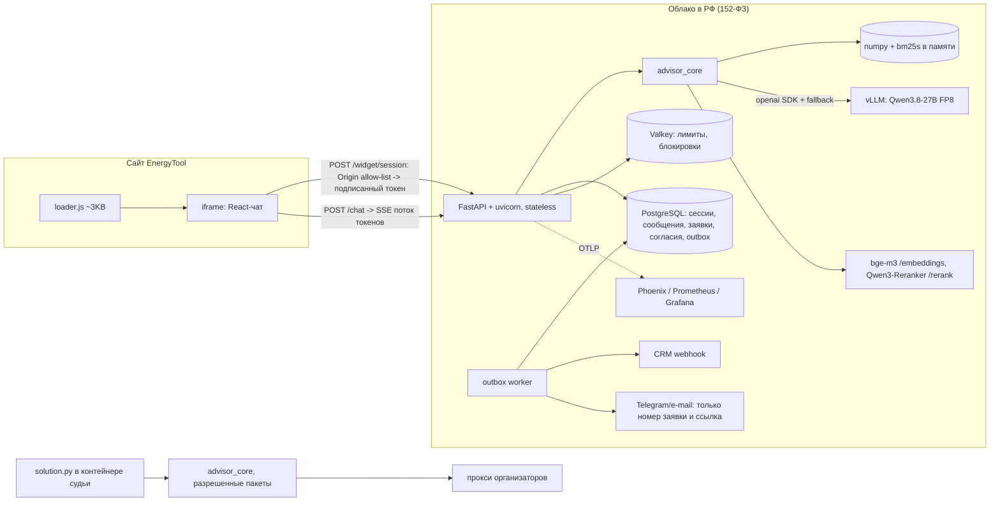

# Решение: ИИ-консультант МТС EnergyTool

Статус: архитектура утверждена по итогам исследования и трех раундов взаимной критики (agent-dump/research/critique/).
Цифры с пометкой [замер] получены на наших стендах, [оценка] - расчет с явными допущениями, [источник] - внешние данные.
Сводка исследования с альтернативами и замерами: [RESEARCH_SUMMARY.md](RESEARCH_SUMMARY.md). План работ: [PLAN.md](PLAN.md).

## 1. Вердикт в одном абзаце

Одно ядро консультанта `advisor_core` на чистом Python (только пакеты из разрешенного списка) используется и в сабмите для LLM-судьи, и в веб-сервисе. Поиск гибридный: разделы базы знаний по заголовкам, bge-m3 + BM25 со стеммингом, взвешенное слияние, опционально Qwen3-Reranker. Ответ - один вызов Qwen3.8-27B без режима рассуждений, промпт v3 в стиле эталонов с 4 примерами. Диалогом и заявкой управляет детерминированный код по небольшому структурированному разбору реплики, LLM никогда не решает, когда просить телефон. Веб: FastAPI + SSE, PostgreSQL, Valkey, outbox для заявок, виджет через JS-загрузчик и iframe. Прод: vLLM на GPU в российском облаке, все данные в РФ.

## 2. Соответствие ТЗ

| Требование ТЗ | Как закрыто |
|---|---|
| 1. Изучить базу знаний | 19 файлов, 234 раздела, 37.7k токенов Qwen3 [замер]. Разделы "Чего утверждать нельзя" используются как источник оговорок |
| 2. RAG | Гибридный поиск по разделам с хлебными крошками, реранкер, метрики на 88 вопросах (раздел 5) |
| 3. Консультант, а не поисковик | Промпт v3: вывод, 1-3 факта под ситуацию клиента, оговорка, один уточняющий вопрос. Отказ при отсутствии факта в базе с предложением специалиста. Нецелевые вопросы: вежливый отказ |
| 4. Сбор заявки | Форма в чате: ФИО, телефон, компания, согласие на ПДн отдельным документом. Триггеры в коде. Резюме для менеджера: JSON + текст |
| 5. Контекст в диалоге, "Новый диалог", история всех сессий | Сессия в PostgreSQL, "Новый диалог" закрывает сессию и открывает новую, история хранится вся, включая диалоги без заявки, есть админ-просмотр |
| 6. Скорость | Один вызов LLM, параллельные этапы, без режима рассуждений, кэш эмбеддингов, таймауты и деградация (раздел 9) |
| 7. Веб-чат с отладкой | React-виджет, стриминг, режим отладки по токену: время по этапам, разделы базы с оценками, разбор реплики |
| 8. Встраивание и передача заявок | `<script>` загрузчик + iframe, allow-list доменов, outbox → webhook в CRM / Telegram-уведомление без ПДн |
| Ограничения | Факты только из базы, честное "этого нет в материалах", до ~90 слов, тестовые ПДн, секреты только в env, база знаний не попадает в репозиторий |

## 3. Архитектура



Почему одно ядро на два контура: логика консультации пишется и тестируется один раз, улучшение промпта сразу поднимает и балл судьи, и качество продукта. Платформа принимает только корневые `.py`, поэтому `build_zip.py` раскладывает пакет `advisor_core` в плоские модули при сборке ZIP.

## 4. Пайплайн ответа

### 4.1 Контур судьи (`solution.py`)

1. Старт: проверка возможностей прокси (probe, ~5 запросов): отключается ли thinking через `chat_template_kwargs.enable_thinking=false` (запасные варианты: `reasoning_effort`, строгий режим с увеличенным `max_tokens` и вырезанием `<think>`), поддержка `json_schema`, формат и скорость `/rerank`, размер эмбеддингов, лимит контекста.
2. Индексация: распаковка `knowledge-base.zip`, разделы по заголовкам, эмбеддинги пакетами через `/embeddings`, bm25s в памяти. Менее 10 секунд [оценка].
3. Сразу пишется `submission.csv` с безопасными ответами для всех ID, дальше атомарная перезапись после каждого готового ответа.
4. На каждый вопрос: разбор диалога → гибридный поиск (последняя реплика + 0.3/0.5 x прошлые реплики клиента) → реранк топ-20 с таймаутом → топ-5 разделов → один вызов LLM (промпт v3, temperature 0, max_tokens 400) → пост-проверка.
5. Планировщик с дедлайном 18 минут: при нехватке времени ступени деградации - без реранкера → только BM25 → извлекающий ответ из лучшего раздела без LLM. CSV всегда полный и валидный.

Почему один вызов, а не "разбор + ответ": на 18 настоящих эталонах (оценка Opus по регламенту) один вызов v3 дал 0.784, три вызова с разбором 0.783 при вдвое большей задержке, старая трехвызовная схема 0.697 [замер]. Разбор реплики ошибался в намерениях (заявка верно в 3 из 7 случаев) и при ложной метке "вне темы" пропускал поиск.

### 4.2 Веб-контур

Этапы запускаются параллельно, на критическом пути только поиск и генерация:
- поиск (эмбеддинг + BM25, затем реранк) и `mini_analyze` (~57 токенов вывода: явная просьба контакта, отказ, сигнал покупки, нецелевой запрос, инъекция, `standalone_query`);
- генерация стримится в SSE;
- по событию `done` код применяет эффекты по фиксированному порядку (карточка контакта, отказ, лимиты) и сохраняет ход.

Бюджет [оценка, уточняется на платформе]: эмбеддинг ≤0.3 с, реранк ≤1.0 с (таймаут, затем без реранка), первый токен 1-3 с, весь ответ 3-6 с на H100.

## 5. Поиск по базе знаний

| Решение | Почему | Замер на 73 вопросах с ответом [замер] |
|---|---|---|
| Разделы по заголовкам H2/H3 с крошкой "Файл > H2 > H3" | База хорошо структурирована, раздел - смысловая единица | dense MRR 0.857 против 0.79 у нарезки фиксированного размера |
| bge-m3 через `/embeddings` | Лучший retrieval на ruMTEB (74.79) [источник], доступен на платформе | dense один: MRR 0.857 |
| BM25 (bm25s) со стеммингом | Русская морфология, PyStemmer запрещен, хватает обрезки до 6 символов | BM25 0.59 → 0.68 со стеммингом; RRF без стемминга роняет гибрид до 0.744 |
| Взвешенное слияние 0.7 dense + 0.3 BM25, без инструкции | Равные веса и чистый RRF хуже dense | 0.881 |
| Реранк топ-20, слияние рангов реранкера и первого этапа (RRF k=60) | Реранкер повышает полноту тройки, но сам по себе путает первое место | Hit@3 0.96, MRR 0.892 (на заменителе 0.6B, нижняя граница) |
| Диалоги: последняя реплика + 0.3 x прошлые реплики клиента | Вся переписка в запросе топит смысл | 0.825 против 0.50 у полной переписки |
| Топ-5 разделов, ~1.1-1.5k токенов контекста | Hit@5 0.97-0.99 | k=8 добавляет менее 2 пунктов |

| Иерархия и граф без LLM: приор родительского H2 (+0.3) и расширение на 1 шаг по доменному графу (соседние разделы, ссылки на файлы, общие редкие числа и номера НПА), λ=0.1 | Подтягивает связанные факты, не тратя токены LLM на индекс | MRR 0.881 → 0.895, Rec@5 0.78 → 0.83 (P=0.96) |
| Фильтр по продукту и региону из структуры файлов (с ростом базы x10+) | Почти одинаковые описания разных продуктов - главная угроза при росте | Без фильтра неверный продукт первым в 4 из 73 вопросов на x23 |

Итоговая формула первого этапа: 0.85·dense + 0.15·BM25 + приор H2 + граф, затем реранк топ-20 (топ-50 при росте) и RRF с первым этапом. Веса 0.7/0.3 и 0.85/0.15 различаются в пределах шума, берем второй как более устойчивый при росте.

Отвергнуто [замер]: подача всей базы или целых файлов в промпт (не масштабируется), фиксированная нарезка, равновесный гибрид, предметная инструкция для реранкера (Hit@1 0.74 → 0.60), GraphRAG-подобные (HippoRAG-2-lite до 0.749, LightRAG-lite до 0.69; многошаговых вопросов 4 из 73), RAPTOR (0.863), маршрутизация по сводкам (0.70-0.75), late chunking (векторы схлопываются к документу), contextual retrieval (612k токенов на индекс, хуже при росте). HyDE лучший при росте (0.883 на x23), но добавляет вызов LLM до первого токена - держим как вариант для очень большой базы.

Масштабирование: при росте базы в 100 раз (~30k разделов) numpy/faiss + bm25s в памяти процесса остаются быстрее сетевых хранилищ (numpy 12 мс, faiss HNSW 0.25 мс против pgvector 1.9 мс и Qdrant 3.3 мс [замер]); индекс собирается один раз по хэшу базы и раздается подам как артефакт. pgvector не берем, потому что лексическая часть гибрида туда не переносится.

## 6. Генерация

- Модель: Qwen3.8-27B, режим рассуждений выключен всегда. С ним 3-6k токенов рассуждения, ~170 с на ответ, треть ответов обрезана, итог судьи 0.657 против 0.85+ [замер на 9B]; пример организаторов с рассуждениями дал заглушку в 61 из 62 ответов.
- Параметры: temperature 0 (переопределяем TEMPERATURE платформы ради воспроизводимости), max_tokens 400 на ответ; MAX_TOKENS платформы не используем для генерации, MAX_WORKERS соблюдаем.
- Промпт v3 (agent-dump/research/gen-lab/prompts.md): вывод в первых словах; 1-3 факта из разделов под ситуацию клиента; оговорка из "Чего утверждать нельзя"; ровно один короткий вопрос об одном самом важном недостающем параметре; 40-90 слов; без markdown и приветствий; "нет" только если материалы это прямо исключают; если факта нет - сказать, что в материалах его нет, дать ближайшие факты и предложить специалиста; никогда не утверждать, что заявка создана, и не повторять телефон.
- 4 примера в стиле эталонов обязательны: без примеров уточняющим вопросом заканчивается 1 ответ из 62 [замер].
- Пост-проверка (код, без LLM): длина, отсутствие разметки, все числа ответа есть в контексте или в репликах клиента, маскирование повторенного телефона. В вебе при провале - перегенерация и SSE-событие `replace`.
- Проверочный второй проход LLM не используем: переписал 53 из 62 ответов без прироста [замер].

## 7. Диалог, заявка, резюме

- Состояние сессии: `lead_phase` (none → offered → form → submitted / declined) и счетчики в JSONB с оптимистичной блокировкой `state_version`. Названия состояний (discovery, recommendation, offer_contact и др.) вычисляются для отладки, а не хранятся.
- Эффекты по фиксированному порядку (E0-E6), каждый покрыт юнит-тестом на подставном результате разбора: блок инъекции, нецелевой вопрос, явная просьба связаться → форма, сигнал покупки (расчет, демо, пилот, оплата) → закрываемая карточка, ответ "только специалист" → карточка, лимит предложений (не более 2 за сессию, не чаще раза в 3 хода, после отказа - только по просьбе клиента).
- Без списков ключевых слов: намерения определяет LLM со схемой и pydantic-валидацией. Детерминированно только то, где LLM опасна: нормализация телефона в +7, длина ввода, маскирование.
- Форма в чате: ФИО, телефон, компания, неотмеченный чекбокс согласия со ссылкой на отдельный документ (152-ФЗ с 01.09.2025). Контакты, написанные в чат, только предзаполняют форму. Заявка создается только через форму, эндпоинт идемпотентен.
- Резюме для менеджера: контакты, согласие и факты берутся из состояния и стенограммы (цитаты клиента сверяются с текстом), LLM пишет только задачу, почему подходят продукты, открытые вопросы, возражения и следующий шаг. Горячий/теплый лид. Формат: JSON для CRM + читаемый текст.

## 8. Веб-сервис и данные

| Слой | Выбор | Почему, кратко |
|---|---|---|
| Python | 3.13 | numpy 2.2.6 из списка платформы не ставится на 3.14 [замер] |
| API | FastAPI + uvicorn[standard] | В разрешенном списке, равен Litestar по скорости [замер] |
| Стриминг | SSE через fetch POST, ручная разметка событий | Встроенный SSE FastAPI в 3 раза медленнее под нагрузкой; ручная разметка: +85 мс на 500 потоках на одном ядре [замер] |
| БД | PostgreSQL 18 + SQLAlchemy 2 async + Alembic | Заявка и outbox в одной транзакции, JSONB для метаданных хода; запись 3.8 мс, чтение 0.66 мс p50 [замер] |
| Кэш, лимиты | Valkey 9 | 0.3-0.4 мс [замер], лицензия BSD |
| Векторы | numpy в памяти | 300 разделов: 0.13 мс против 3-4 мс у Qdrant/pgvector [замер] |
| Заявки | Outbox-таблица + воркер (SKIP LOCKED), адаптеры Log/Webhook | Нет потери заявки при сбое отправки, без брокера |
| Виджет | JS-загрузчик + iframe, React 19 + Vite | Изоляция стилей и скриптов от сайта, свой CSP |
| Отладка | `?debug` по серверному токену: время этапов, разделы и оценки, разбор, токены | Без токена отладка раскрывала бы промпты и базу знаний |
| Админ | Просмотр всех сессий и заявок | Требование допуска: история всех сессий доступна для проверки |

Схема: `sessions`, `messages` (статус, `client_msg_id`, метаданные хода), `leads` (уникальна на сессию), `consents` (версия текста, время, `ip_hmac`), `outbox`.

## 9. Скорость: оптимизации и их эффект

| Оптимизация | Эффект |
|---|---|
| Thinking выключен | ~170 с → единицы секунд на ответ [замер 9B] |
| Один вызов LLM вместо разбора + ответа | Задержка вдвое ниже при том же балле (6.5 против 12.3 с на 9B) [замер] |
| Разбор реплики в вебе параллельно поиску, ~57 токенов вместо ~400 | Убирает 5-8 с с критического пути [оценка] |
| Статичный системный промпт и примеры в начале запроса | Попадание в prefix cache vLLM, TTFT -59-80% в бенчмарках [источник] |
| Контекст: 5 разделов, ~1.4k токенов | Короткий prefill, без потери полноты |
| Реранк с таймаутом и откатом | Hit@1 без реранка тот же (0.82), задержка не растет при медленном реранкере |
| numpy вместо сетевой векторной БД | 0.13 мс против 3-4 мс |
| Ручной SSE | 3x запас по CPU на потоках |
| Параллелизм MAX_WORKERS + дедлайн 18 мин | Полный CSV при любой скорости прокси; 300 вопросов ≈5 мин при 3 воркерах [оценка] |

## 10. Безопасность и 152-ФЗ

- Инъекции: классификация в `mini_analyze` (0 ложных блокировок на 30 вопросах про хищения и отключения, 10 из 10 атак без выполнения [замер 9B]), данные базы в промпте как данные с разделителями, у бота нет инструментов кроме сохранения заявки по схеме. Qwen3Guard - в теневом режиме до прохождения того же теста.
- ПДн: только тестовые на хакатоне; маскирование телефонов и e-mail в логах и трассах в два прохода (значения из формы + детерминированный шаблон); Telegram получает только номер заявки и ссылку; хранение и LLM в РФ; согласие отдельным документом с версией текста; сроки хранения задаются задачей очистки.
- Доступ: подписанный токен виджета (15 мин, привязка к сайту и Origin), CORS и `frame-ancestors` по allow-list, лимиты на сессию, токен и IP.
- Цепочка поставок: `uv.lock` с хэшами, pip-audit, Trivy по дайджесту, actions по SHA, gitleaks. LiteLLM не используем (две компрометации релизов в 2026 [источник]).
- Контейнеры: python:3.13-slim, non-root, read-only FS, cap_drop ALL, healthchecks.
- Маппинг на OWASP LLM Top 10 2025 - в agent-dump/research/stack.md, раздел 7.

## 11. Прод и масштабирование

- LLM: vLLM 0.33, Qwen3.8-27B FP8 + FP8 KV, prefix caching (align), xgrammar для JSON. SGLang - проверенная альтернатива через тот же OpenAI API. TGI в режиме поддержки, отвергнут.
- Размер [оценка]: 100 одновременных чатов ≈ 17 активных последовательностей в среднем, до 40 в пике; 1x H100 80 GB с FP8 держит с двукратным запасом; в проде 2 реплики.
- Запасной провайдер: внутренние модели MWS GPT или Cloud.ru (данные не покидают РФ), строгий allow-list идентификаторов моделей.
- API stateless, горизонтально масштабируется по CPU и числу потоков; vLLM масштабируется по очереди запросов.
- Наблюдаемость: OpenTelemetry (GenAI semconv) → Prometheus/Grafana, трассировка LLM в Phoenix (один контейнер), Langfuse при необходимости управления промптами.

## 12. Качество: как меряем

- Основная метрика: реплика судьи по регламенту (два раунда со сменой позиций, 5 уровней, 0.7 x MatchRate + 0.3 x WinRate) против baseline организаторов, на 18 настоящих эталонах, оценивает сильная модель.
- Вспомогательные: судья на локальной модели по 62 вопросам (только "лучше ли сломанного baseline"), поведенческие метрики (один вопрос в конце, длина, двойные вопросы, утверждения о заявке), обязательные проверки фактов на проблемных вопросах, регрессия поиска без LLM в CI.
- Решающий сигнал - реальные сабмиты: 5 в день, каждый проверяет одну гипотезу.

## 13. Структура репозитория и запуск

```
src/advisor_core/   kb, retrieval, llm, prompts, pipeline, policy, schemas  (только разрешенные пакеты)
src/api/            FastAPI: chat SSE, widget, leads, admin, db, outbox worker
src/web/            React-виджет и loader.js
submission/         solution.py, build_zip.py (плоские модули + requirements.txt)
eval/               реплика судьи, golden-18, поведенческие метрики, регрессия поиска
compose.yaml, Dockerfile, .dockerignore, .env.example, README.md
```

Запуск: `docker compose up -d`, переменные `LLM_BASE_URL`, `LLM_API_KEY`, `LLM_MODEL`, `EMB_MODEL`, `RERANKER_MODEL`, `DEBUG_TOKEN`, `DATABASE_URL`, `KB_PATH`. База знаний монтируется томом и в репозиторий не попадает.

## 14. Известные ограничения и риски

- Возможности прокси (отключение thinking, json_schema, формат `/rerank`, его задержка) не проверены до первого сабмита; решение деградирует автоматически.
- Все замеры генерации получены на Qwen3.5-9B (8 ГБ VRAM); на 27B абсолютное качество выше, относительные выводы переносятся.
- Эталонов только 18; различия меньше ~0.05 - шум. Эталоны для 44 дополнительных вопросов писал тот же агент, что подбирал промпт, поэтому они вторичны.
- Известные слабости 9B: ответ "нет" там, где нужно "может иметь смысл" (d14), возврат к теме после отвлечения. Перепроверить на 27B.
- Пороги отсечения нецелевых вопросов (cos 0.45/0.53) подобраны на локальных моделях, нужна перекалибровка на реальных оценках прокси.
